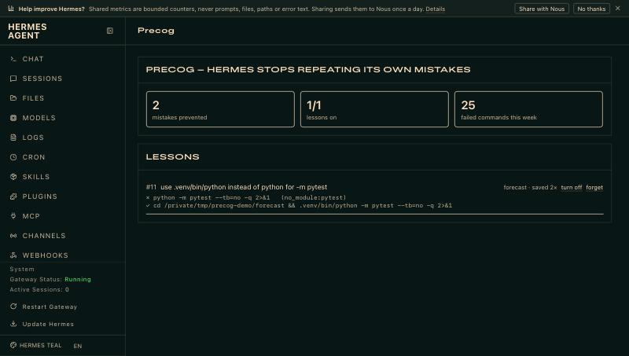

# Precog

**Hermes stops repeating its own mistakes.**

Agents work by trial and error: run a command, read the error, try again. The
fix they find is real knowledge about *your* machine and *your* project
(`python3` here is the system Python without pytest; this repo needs `pnpm`;
tests only pass with the project venv). The next session forgets all of it and pays
for the same mistake again.

Precog keeps that knowledge. Every time a terminal command fails and a later
command fixes it, Precog stores the pair as a **lesson**, verified by the real
exit codes. Before the next command runs, in any session, Precog applies the
lesson, so the mistake never happens again. No extra model calls.

```
Session 1                                   Session 2 (fresh context)
─────────                                   ─────────────────────────
$ python -m pytest -q                       model writes: python -m pytest -q
  No module named pytest        ✗           Precog rewrites before it runs:
$ python -m unittest discover   (detour)    $ .venv/bin/python -m pytest -q
$ .venv/bin/python -m pytest -q               2 passed                    ✓
  2 passed                      ✓
  → Precog learned lesson #1                0 failed attempts, 0 wasted turns
```



## Measured on a live Hermes session

Hermes 0.23, `deepseek/deepseek-v4-flash`, the demo project in
[`examples/forecast`](examples/forecast) (tests only pass with the project venv),
the same prompt each time: *"Run this project's test suite and tell me how many
tests passed."*

| | Session 1 (learns) | Session 2 (briefed) | Session 3 (rewrite, briefing off) |
|---|---|---|---|
| Tool calls | 8 | **1** | **1** |
| Model calls | 7 | **2** | **2** |
| Output tokens | 1,015 | **150** | **128** |
| Failed commands | 1 failure + a `unittest` detour | **0** | **0** |
| What happened | `python -m pytest` failed, found `.venv`, Precog learned it | the model read Precog's briefing and used `.venv/bin/python` first | the model typed `python -m pytest`; Precog ran `.venv/bin/python -m pytest` |

Replaying 331 real terminal results from an existing Hermes history, Precog
learned 3 lessons (all environment facts: "tests need the venv activated",
"`python3` lacks `yaml`") and none from failing tests or script bugs.

## What it does

| | |
|---|---|
| **Learns from evidence** | `post_tool_call` reads every terminal result. A failure followed by a successful command that does the same job becomes a lesson. The model's own opinion is never the signal; exit codes are. |
| **Fixes before it runs** | Lessons are applied in `tool_request` middleware, which runs *before* Hermes's guardrails and approval prompt, so you always approve the command that will actually run. |
| **Five lesson kinds** | swap the program (`python3` → `.venv/bin/python`, `npm` → `pnpm`), add a missing prefix (`. .venv/bin/activate &&`), swap a flag the installed tool rejects (`--crf` → `-crf`), swap a path that does not exist, or keep a plain hint. |
| **Tripwire** | A command that already failed in this project, with no safe automatic fix, is stopped once per session with what worked last time. Running it again goes through. |
| **Briefing** | Once per project per session, the top lessons are added to the user turn (never the system prompt, so the prompt cache is untouched). |
| **Self-correcting** | Every applied lesson is scored on the next result. A lesson that keeps failing (the environment changed) turns itself off; seeing the fix again turns it back on. |
| **Scoped** | Lessons belong to a project (nearest `.git`). A program fix seen in two different projects is promoted to a machine-wide lesson. |
| **Visible** | The model sees a `precog` note on every rewritten result. Desktop shows a `precog · N saved` status chip, a lessons workspace and toasts; the web dashboard gets a Precog tab. |

## Install

```bash
hermes plugins install 0xNomind/precog --enable
```

Or from a checkout:

```bash
git clone https://github.com/0xNomind/precog ~/.hermes/plugins/precog
hermes plugins enable precog
```

Requires Hermes 0.23 or newer. No API keys, no network, no extra dependencies.

## Use

Nothing to do: Precog learns as Hermes works. To look inside:

```
/precog                     status for the current project
/precog list                every lesson, with how often it was applied and saved
/precog off 3 | on 3        turn a lesson off or on
/precog forget 3            delete a lesson
/precog mode suggest        auto | suggest | learn | off
/precog teach npm test => pnpm test
```

```bash
hermes precog stats
hermes precog list
hermes precog export lessons.json
```

### Modes

| Mode | Behaviour |
|---|---|
| `auto` (default) | Rewrite known mistakes before they run. |
| `suggest` | Stop the command and show the learned fix; the model decides. |
| `learn` | Collect lessons, change nothing. |
| `off` | Do nothing. |

Settings (Desktop → Settings → Plugins → Precog, or `plugins.entries.precog.settings` in `config.yaml`):
`mode`, `briefing`, `max_briefing`, `tripwire`, `annotate`, `pair_window`.

## Try the demo

`examples/forecast` is a tiny Python project whose tests only pass with its
own venv, the most common trap there is. The setup script copies it to
`/tmp/precog-demo/forecast` as its own git repo (needs [uv](https://docs.astral.sh/uv/)):

```bash
examples/setup-forecast.sh
cd /tmp/precog-demo/forecast
hermes chat -q "Run this project's test suite and tell me how many tests passed."   # session 1: learns
hermes chat -q "Run this project's test suite and tell me how many tests passed."   # session 2: right first time
hermes precog list
```

## How it works

```
model tool call
   │
   ▼
tool_request middleware ── apply lessons for this project ──► rewritten command
   │                                                         (+ note for the model)
   ▼
pre_tool_call ── tripwire for known-failing commands
   │
   ▼
Hermes guardrails + approval  ──►  terminal runs
   │
   ▼
post_tool_call ── score applied lessons · record failure · pair failure → fix → lesson
   │
   ▼
transform_tool_result ── tell the model what Precog did
```

The engine (`engine.py`) is pure Python: a quote-, heredoc- and redirect-aware
shell splitter that keeps character offsets (so rewrites touch only the right
token), an error-signature reader (`No module named X`, `command not found`,
wrong package manager, Python version, unknown flag, missing file, …), a
pairing score, and lesson extraction. `store.py` keeps lessons and a rolling
event log in `<hermes home>/plugin-data/precog/precog.db`.

## Privacy and disclosure

- Precog reads the arguments and results of `terminal` tool calls. Commands and
  error lines are passed through Hermes's own secret redactor before they are
  stored, and only a short error excerpt is kept, never full output.
- Everything stays local in `<hermes home>/plugin-data/precog/`. No network
  calls, no telemetry, no background processes.
- In `auto` mode Precog changes commands before they run, using fixes that
  already succeeded in the same project. Changes happen before Hermes's
  approval check and are shown to the model in the tool result. `suggest` mode
  never changes a command.

## Develop

```bash
python -m pytest tests -q          # 39 tests, no Hermes needed
hermes plugins validate . --install-deps
hermes plugins doctor . --ci
```

## License

MIT
